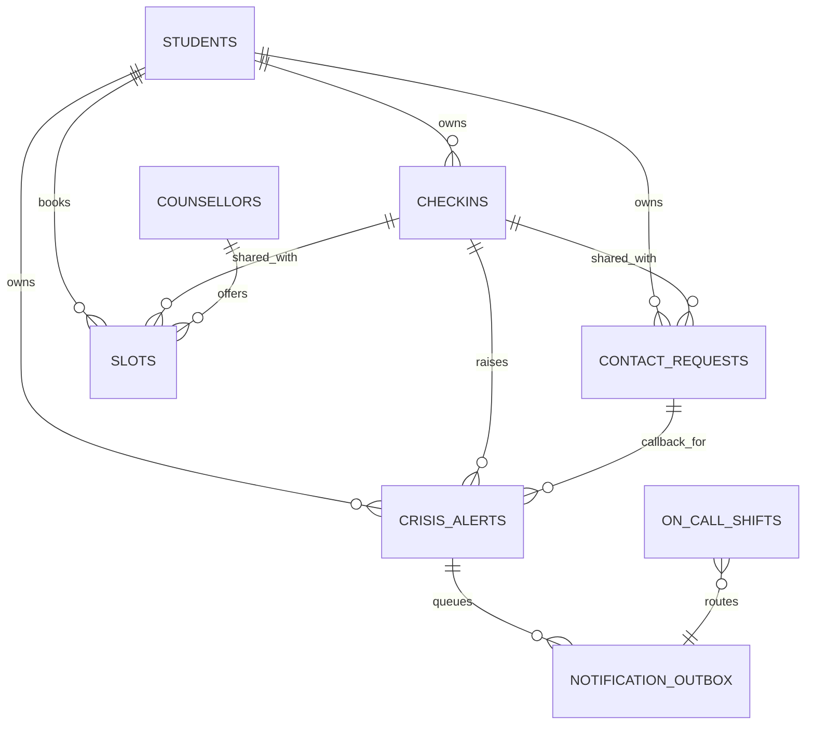

# db.md — Database reference

Canonical reference for the Aatman PostgreSQL schema.

- Schema source of truth: `src/lib/db/schema.ts`
- SQL migrations: `drizzle/`
- Dialect: PostgreSQL 17 (bundled) or any managed Postgres
- Local/test: PGlite (`pglite:./.data/pglite`, `pglite:memory`) with the same migrations
- ORM: Drizzle (`drizzle-orm/node-postgres` or `drizzle-orm/pglite`)

---

## Design rules

1. **Students are identified by an HMAC pseudonym, never by email/name/roll number.**
2. **Clinical content, contact details, and notes are encrypted per field** (AES-256-GCM,
   AAD = owner pseudonym).
3. **`tier` and timestamps stay plaintext** so routing, retention, and k-anonymous aggregates
   work without decrypting.
4. **Free text and chat are not stored at all.**
5. **Deletes are real.** No soft-delete columns; cascades and `SET NULL` define lifecycle.
6. **Every student-scoped query filters by `pseudonym`.**

Legacy migration `0000_init` created the core tables before later columns were added; the
Drizzle schema is the current shape. The list below is the current shape, not the historical
one.

---

## Enum-like text columns

Drizzle uses `text(..., { enum: [...] })`. There is **no database enum type**; constraints are
enforced by TypeScript and application code. Values in the database outside these sets would be
a bug, not a DB error.

| Column | Allowed values |
|---|---|
| `checkins.tier`, `contact_requests.tier` | `mild`, `moderate`, `elevated`, `urgent`, `crisis` |
| `checkins.summary_source` | `llm`, `template` |
| `contact_requests.status` | `new`, `contacted`, `closed` |
| `crisis_alerts.tier` | `crisis`, `urgent` |
| `crisis_alerts.status` | `open`, `acknowledged`, `resolved` |
| `on_call_shifts.role` | `counsellor`, `clinical_lead` |
| `notification_outbox.kind` | `crisis_alert`, `crisis_escalation` |
| `notification_outbox.status` | `pending`, `sending`, `sent`, `dead` |
| `slots.mode` | `in_person`, `phone`, `video` |
| `slots.status` | `open`, `booked`, `cancelled` |

---

## 1. `students`

The account anchor. One row per pseudonym. Created on first student sign-in.

| Column | Type | Null | Default | Notes |
|---|---|---|---|---|
| `pseudonym` | `text` | no | — | **PK**. `p_` + base64url HMAC-SHA256 of lowercase email |
| `created_at` | `timestamptz` | no | `now()` | |
| `consent_version` | `text` | yes | — | e.g. `2026-10-v1` |
| `consent_at` | `timestamptz` | yes | — | when current consent was recorded |

- No email, name, roll number, phone, or demographics.
- `pseudonym` is stable for a given email + `PSEUDONYM_KEY`.
- Deleting this row cascades to `checkins`, `contact_requests`, `crisis_alerts`; it sets
  `slots.booked_by` to NULL.

**Indexes:** primary key only.

---

## 2. `checkins`

One completed screening session.

| Column | Type | Null | Default | Notes |
|---|---|---|---|---|
| `id` | `uuid` | no | `gen_random_uuid()` | **PK** |
| `pseudonym` | `text` | no | — | FK → `students.pseudonym` **ON DELETE CASCADE** |
| `created_at` | `timestamptz` | no | `now()` | plaintext for ordering/retention/aggregates |
| `tier` | `text` | no | — | `mild`…`crisis`; plaintext for aggregates |
| `payload_enc` | `text` | no | — | AES-GCM JSON: answers (no free text), campus, triage, locale |
| `summary_enc` | `text` | yes | — | AES-GCM string |
| `summary_source` | `text` | yes | — | `llm` or `template` |
| `keep` | `boolean` | no | `false` | exempts from retention |

### `payload_enc` plaintext shape

```ts
{
  answers: {
    phq9: (0|1|2|3|null)[9],
    gad7: (0|1|2|3|null)[7],
    cssrs?: {
      wishToBeDead, activeThoughts,
      method?, intent?, planWithIntent?,
      behavior: "never" | "over_3_months_ago" | "within_3_months" | null
    }
  },
  campus: {
    sleep, academics, social?, substances?,
    safety: "no" | "yes" | "prefer_not" | null
  },
  triage: PublicTriage,   // TriageResult without textDetection
  locale: "en" | "hi"
}
```

**Never present:** the original free text, matched lexicon ids, or identity.

**Indices**

| Name | Columns | Purpose |
|---|---|---|
| `checkins_owner_idx` | `(pseudonym, created_at)` | Student history |
| `checkins_created_idx` | `(created_at)` | Retention and weekly aggregates |

**Cascades**

- Student deletion → check-ins deleted.
- Check-in deletion → `contact_requests.checkin_id` and `slots.shared_checkin_id` set NULL.

---

## 3. `contact_requests`

A student's explicit opt-in to share one check-in and callback details.

| Column | Type | Null | Default | Notes |
|---|---|---|---|---|
| `id` | `uuid` | no | `gen_random_uuid()` | **PK** |
| `pseudonym` | `text` | no | — | FK → students **CASCADE** |
| `checkin_id` | `uuid` | yes | — | FK → checkins **SET NULL** |
| `created_at` | `timestamptz` | no | `now()` | |
| `tier` | `text` | no | — | copied from the check-in |
| `contact_enc` | `text` | no | — | AES-GCM `{ name?, phone?, email?, bestTime? }` |
| `status` | `text` | no | `'new'` | `new`, `contacted`, `closed` |
| `handled_by` | `text` | yes | — | staff email |
| `contacted_at` | `timestamptz` | yes | — | first contact |
| `closed_at` | `timestamptz` | yes | — | |

**Index:** `contact_requests_status_idx (status, created_at)` — queue queries and retention.

**Business caps:** max 3 open (`new` + `contacted`) per student.

**Links:** an open alert can point at the request (`crisis_alerts.contact_request_id`).

---

## 4. `crisis_alerts`

A pointer that a crisis/urgent check-in needs a human. Deliberately contains no answers,
scores, free text, or contact details.

| Column | Type | Null | Default | Notes |
|---|---|---|---|---|
| `id` | `uuid` | no | `gen_random_uuid()` | **PK** |
| `pseudonym` | `text` | no | — | FK → students **CASCADE** |
| `checkin_id` | `uuid` | yes | — | FK → checkins **SET NULL** |
| `contact_request_id` | `uuid` | yes | — | FK → contact_requests **SET NULL** |
| `created_at` | `timestamptz` | no | `now()` | |
| `tier` | `text` | no | — | `crisis` or `urgent` |
| `status` | `text` | no | `'open'` | `open`, `acknowledged`, `resolved` |
| `acknowledged_at` | `timestamptz` | yes | — | |
| `acknowledged_by` | `text` | yes | — | staff email |
| `escalated_at` | `timestamptz` | yes | — | last escalation |
| `escalation_level` | `integer` | no | `0` | 0–3 |
| `resolved_at` | `timestamptz` | yes | — | |
| `resolved_by` | `text` | yes | — | staff email |
| `note_enc` | `text` | yes | — | AES-GCM resolution note |

**Indices**

| Name | Columns | Purpose |
|---|---|---|
| `crisis_alerts_open_idx` | `(status, created_at)` | Queue and escalation |
| `crisis_alerts_pseudonym_idx` | `(pseudonym, created_at)` | Linking contact requests; student history |

**Retention:** resolved alerts older than the cutoff are deleted.

---

## 5. `on_call_shifts`

Who receives crisis alerts.

| Column | Type | Null | Default | Notes |
|---|---|---|---|---|
| `id` | `uuid` | no | `gen_random_uuid()` | **PK** |
| `staff_email` | `text` | no | — | not a FK |
| `role` | `text` | no | `'counsellor'` | `counsellor`, `clinical_lead` |
| `starts_at` | `timestamptz` | no | — | inclusive |
| `ends_at` | `timestamptz` | no | — | exclusive |
| `backup_email` | `text` | yes | — | escalation level 1 target |
| `created_at` | `timestamptz` | no | `now()` | |

**Index:** `on_call_window_idx (starts_at, ends_at)` — active-shift lookup.

**Rules:** end > start; duration ≤ 7 days. No overlap validation; the newest/all active
shifts all receive initial alerts.

---

## 6. `notification_outbox`

Transactional queue for PII-free staff notifications.

| Column | Type | Null | Default | Notes |
|---|---|---|---|---|
| `id` | `uuid` | no | `gen_random_uuid()` | **PK** |
| `kind` | `text` | no | — | `crisis_alert`, `crisis_escalation` |
| `to_email` | `text` | no | — | staff recipient |
| `subject` | `text` | no | — | |
| `body` | `text` | no | — | alert id + URL only |
| `status` | `text` | no | `'pending'` | `pending`, `sending`, `sent`, `dead` |
| `attempts` | `integer` | no | `0` | |
| `next_attempt_at` | `timestamptz` | no | `now()` | backoff |
| `claimed_at` | `timestamptz` | yes | — | stale-claim reset |
| `sent_at` | `timestamptz` | yes | — | |
| `last_error` | `text` | yes | — | truncated to 500 chars |
| `created_at` | `timestamptz` | no | `now()` | |

**Index:** `outbox_due_idx (status, next_attempt_at)` — claim query.

**Retention:** `sent`/`dead` older than 30 days.

**Contract:** never put student data in `subject` or `body`.

---

## 7. `counsellors`

Public counsellor directory, joined by email from slots.

| Column | Type | Null | Default | Notes |
|---|---|---|---|---|
| `email` | `text` | no | — | **PK** |
| `display_name` | `text` | no | — | max 80 in service |
| `languages` | `text` | no | `''` | free text, max 160 |
| `bio` | `text` | yes | — | max 600 |
| `active` | `boolean` | no | `true` | not currently used for filtering |
| `updated_at` | `timestamptz` | no | `now()` | |

**No FK from `slots.counsellor_email`.** A slot can exist without a profile; the API returns
`null` name/languages. This keeps legacy slot rows working.

---

## 8. `slots`

Bookable counselling intervals.

| Column | Type | Null | Default | Notes |
|---|---|---|---|---|
| `id` | `uuid` | no | `gen_random_uuid()` | **PK** |
| `counsellor_email` | `text` | no | — | links to `counsellors.email` by convention |
| `starts_at` | `timestamptz` | no | — | |
| `ends_at` | `timestamptz` | no | — | |
| `location` | `text` | no | — | |
| `mode` | `text` | no | `'in_person'` | `in_person`, `phone`, `video` |
| `status` | `text` | no | `'open'` | `open`, `booked`, `cancelled` |
| `booked_by` | `text` | yes | — | FK → students **SET NULL** |
| `booked_at` | `timestamptz` | yes | — | |
| `shared_checkin_id` | `uuid` | yes | — | FK → checkins **SET NULL** |
| `contact_enc` | `text` | yes | — | AES-GCM `{ phone }` |
| `is_urgent` | `boolean` | no | `false` | priority slot |
| `reminder_opt_in` | `boolean` | no | `false` | requires phone |
| `reminder_24_attempt_at` | `timestamptz` | yes | — | throttle |
| `reminder_24_sent_at` | `timestamptz` | yes | — | |
| `reminder_2_attempt_at` | `timestamptz` | yes | — | |
| `reminder_2_sent_at` | `timestamptz` | yes | — | |
| `attended_at` | `timestamptz` | yes | — | mutually exclusive with no_show |
| `no_show_at` | `timestamptz` | yes | — | |
| `marked_by` | `text` | yes | — | staff email |
| `created_at` | `timestamptz` | no | `now()` | |

**Indices**

| Name | Columns | Purpose |
|---|---|---|
| `slots_time_idx` | `(starts_at)` | Listing and window queries |
| `slots_booker_idx` | `(booked_by)` | Student bookings |

**Retention:** slots with `ends_at` older than the cutoff are deleted.

---

## 9. `audit_log`

Append-only accountability record.

| Column | Type | Null | Default | Notes |
|---|---|---|---|---|
| `id` | `uuid` | no | `gen_random_uuid()` | **PK** |
| `at` | `timestamptz` | no | `now()` | |
| `actor` | `text` | no | — | staff email, `student`, `system` |
| `action` | `text` | no | — | union in code (`AuditAction`) |
| `target_type` | `text` | yes | — | e.g. `contact_request` |
| `target_id` | `text` | yes | — | record id or count summary |

**Index:** `audit_log_at_idx (at)` — time-range review.

**No content**, no pseudonym as target, no IP/user agent. Retention 36 months.

---

## 10. `rate_limits`

Fixed-window counters shared across replicas.

| Column | Type | Null | Default | Notes |
|---|---|---|---|---|
| `key` | `text` | no | — | **PK**, SHA-256 of the logical key |
| `window_start` | `bigint` | no | — | epoch milliseconds |
| `count` | `integer` | no | — | |

**Index:** `rate_limits_window_idx (window_start)` — sweep query.

**Sweep:** rows older than 24 h are deleted by retention.

---

## Relationships



The `counsellors → slots` relationship is logical (email match), not a database FK.
`on_call_shifts → outbox` is also logical: recipients are copied into outbox rows.

## Foreign-key actions

| FK | On delete |
|---|---|
| `checkins.pseudonym → students` | CASCADE |
| `contact_requests.pseudonym → students` | CASCADE |
| `crisis_alerts.pseudonym → students` | CASCADE |
| `contact_requests.checkin_id → checkins` | SET NULL |
| `crisis_alerts.checkin_id → checkins` | SET NULL |
| `crisis_alerts.contact_request_id → contact_requests` | SET NULL |
| `slots.booked_by → students` | SET NULL |
| `slots.shared_checkin_id → checkins` | SET NULL |

Why `SET NULL` for pointers: deleting a check-in should not delete a booking or an alert; it
should remove the shared content while preserving the operational record.

## Encryption map

| Column | Encrypted | AAD | Contents |
|---|---|---|---|
| `checkins.payload_enc` | ✅ | owner pseudonym | answers, campus, triage, locale |
| `checkins.summary_enc` | ✅ | owner pseudonym | summary text |
| `contact_requests.contact_enc` | ✅ | owner pseudonym | callback details |
| `slots.contact_enc` | ✅ | owner pseudonym | phone |
| `crisis_alerts.note_enc` | ✅ | owner pseudonym | resolution note |
| `checkins.tier`, `created_at` | ❌ | — | aggregates |
| `students.pseudonym` | ❌ (HMAC) | — | identity link only with key |
| `audit_log.*` | ❌ | — | ids, no content |
| `notification_outbox.body` | ❌ | — | PII-free by contract |

Format: `v1.<base64url(iv[12] | ciphertext | tag[16])>`.

## Common queries

### Owner-scoped check-in

```sql
SELECT * FROM checkins
WHERE id = $1 AND pseudonym = $2;
```

### Latest check-in

```sql
SELECT * FROM checkins
WHERE pseudonym = $1
ORDER BY created_at DESC
LIMIT 1;
```

### Open queue by severity

```sql
SELECT id, created_at, tier, status, handled_by
FROM contact_requests
WHERE status IN ('new','contacted');
-- application sorts by tier severity, then newest
```

### Bookable slots

```sql
SELECT s.*, c.display_name, c.languages
FROM slots s
LEFT JOIN counsellors c ON c.email = s.counsellor_email
WHERE s.status = 'open'
  AND s.starts_at > $now
  AND s.starts_at < $now + interval '14 days'
  AND ($include_urgent OR s.is_urgent = false)
ORDER BY s.starts_at;
```

### Atomic booking

```sql
UPDATE slots
SET status = 'booked', booked_by = $p, booked_at = $now,
    shared_checkin_id = $shared, contact_enc = $contact,
    reminder_opt_in = $remind
WHERE id = $id AND status = 'open' AND starts_at > $now
RETURNING id;
```

### Due outbox

```sql
SELECT * FROM notification_outbox
WHERE status = 'pending' AND next_attempt_at <= $now
ORDER BY created_at
LIMIT 20
FOR UPDATE SKIP LOCKED;
```

### Weekly aggregates

```sql
SELECT to_char(date_trunc('week', created_at), 'YYYY-MM-DD') AS week,
       tier, count(*)::int
FROM checkins
WHERE created_at >= $since
GROUP BY week, tier;
```

## Index rationale

| Index | Query it serves |
|---|---|
| `checkins_owner_idx` | History and latest-check-in |
| `checkins_created_idx` | Retention delete and weekly aggregation |
| `contact_requests_status_idx` | Queue and closed-request retention |
| `crisis_alerts_open_idx` | Alert queue and escalation |
| `crisis_alerts_pseudonym_idx` | Link callback requests |
| `on_call_window_idx` | Active-shift lookup |
| `outbox_due_idx` | Claim due notifications |
| `slots_time_idx` | Slot listing |
| `slots_booker_idx` | Student bookings |
| `audit_log_at_idx` | Audit time-range review |
| `rate_limits_window_idx` | Sweep |

No index on `slots.is_urgent`; the 14-day window with `starts_at` is small and selective
enough at pilot scale.

## Local development

```bash
# persistent local database, auto-migrated on connection
DATABASE_URL=pglite:./.data/pglite pnpm dev

# in-memory (tests / ephemeral)
DATABASE_URL=pglite:memory pnpm dev
```

`.data/pglite` is gitignored. Deleting the directory resets local data.

## Production migrations

- The VPS release runs a one-shot `migrate` image before rolling app replicas.
- `scripts/migrate.mjs` refuses a `pglite:` URL.
- Migrations are **forward-only**; rollback is a code rollback to a release compatible with
  the current schema.
- Always back up before a destructive migration.

See [Migrations](migrations.md).

## Verification queries

```sql
-- Schema sanity
SELECT table_name FROM information_schema.tables
WHERE table_schema = 'public' ORDER BY 1;

-- No plaintext free text column should exist
SELECT column_name FROM information_schema.columns
WHERE table_name = 'checkins';

-- Confirm sealed columns are populated
SELECT count(*) FILTER (WHERE payload_enc LIKE 'v1.%') AS sealed,
       count(*) AS total
FROM checkins;

-- Orphan check: should be zero
SELECT count(*) FROM checkins c
LEFT JOIN students s ON s.pseudonym = c.pseudonym
WHERE s.pseudonym IS NULL;
```

## Related reading

- [ERD and data model](erd-and-data-model.md)
- [Migrations](migrations.md)
- [Privacy and crypto](../03-domains/privacy-and-crypto.md)
- [Retention and erasure](../03-domains/retention-and-erasure.md)
- [Backend architecture](../01-architecture/backend-architecture.md)
